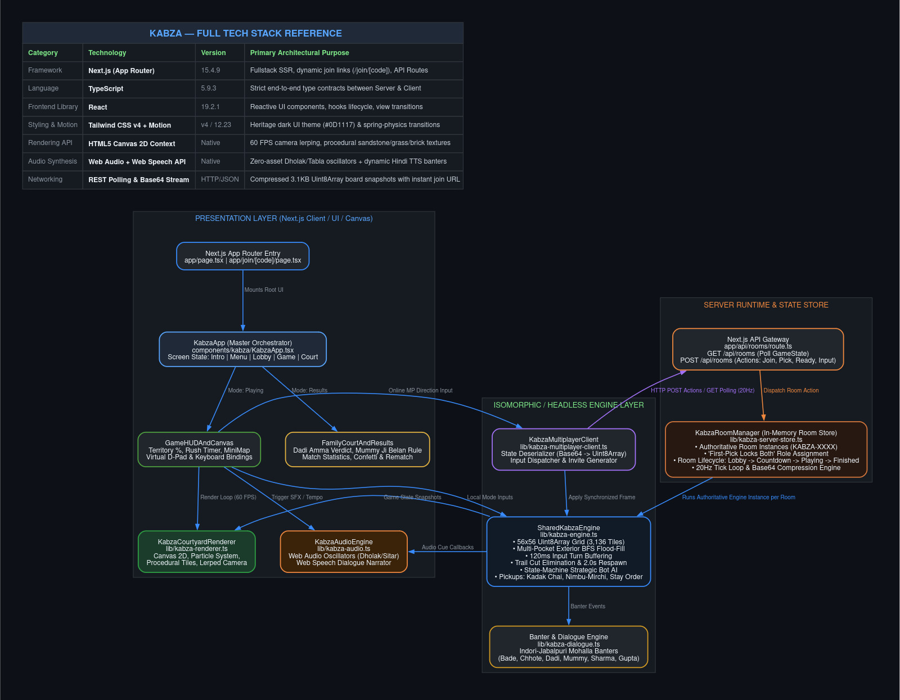
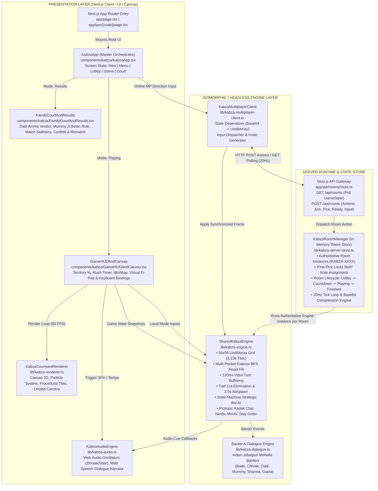

# KABZA — THE GREAT PROPERTY WAR
**"Baap ki property hai Badshah, par kabza karke dikha!"**

A complete 2D top-down multiplayer territory-capture arcade game set in a ridiculous ancestral-property dispute between two brothers (**Bade** and **Chhote**) in Indore/Jabalpur, Madhya Pradesh.

---

## 1. Quick Start & Local Development

```bash
npm install
npm run dev
```

Open `http://localhost:3000` in your browser.
- To test **Online Multiplayer** locally, create a room in one browser window/tab (`KABZA-XXXX`) and open the generated `/join/KABZA-XXXX` invitation link in a second browser window/tab.

---

## 2. Game Concept & Core Mechanics

Two brothers (**Bade Bhaiya** and **Chhote Badshah**) have inherited their ancestral family bungalow and courtyard. Neither wants to share it.
- **Safe Territory**: Bade owns the **Lush Green Lawn**; Chhote owns the **Red Terracotta Bricks**. Inside your owned territory, you are completely safe.
- **Exposed Trail & Loop Capture**: Step onto neutral sandstone courtyard tiles (or rival territory) to paint a vulnerable trail. Return to your safe territory to close the loop—our **Multi-Pocket Exterior BFS Flood-Fill** algorithm immediately captures all enclosed tiles!
- **Trail Cutting & Elimination**: Run across your brother's exposed trail to eliminate him! Eliminated brothers lose their active unclosed trail and respawn inside their safe territory after **2.0 seconds** while keeping their already-captured land.
- **Corner-Assist Input Buffering**: A 120ms turn pre-buffer queues 90° turns smoothly at tile intersections.
- **Ancestral "Jugaad" Courtyard Pickups**:
  - ☕ **Adrak Wali Kadak Chai**: 1.35× sprint speed boost for 5.5s.
  - 🍋 **Nimbu-Mirchi Nazar Battu**: Protects your exposed trail against 1 enemy cut attempt.
  - 📜 **Gupta Ji's Stay Order**: Slows your rival brother by 35% for 4.0s.
- **Final 20-Second "Registry Rush"**: Music tempo accelerates and both brothers get a 1.15× adrenaline boost in the final 20 seconds.

---

## 3. Characters & Indori-Jabalpur "Badshah" Banter Engine

All spoken lines, subtitles, tutorial steps, error messages, and post-match verdicts follow a natural **Indori Hindi + Jabalpur-style "Badshah"** identity:
- **Bade**: Stocky, handlebar moustache, aggressive, teal shirt.
- **Chhote**: Slim, sunglasses on messy hair, sarcastic, red floral shirt.
- **Dadi Amma (Supreme Family Judge)**: Watches from her veranda charpai with her walking stick and delivers the Post-Match Family Court verdict.
- **Mummy Ji (The Ultimate Authority)**: Appears at the kitchen veranda with her wooden *belan* (rolling pin).
- **Sharma Ji (The Neighbour)**: Watches over the east boundary wall with his newspaper and chai cup, updating the colony WhatsApp group.
- **Gupta Ji (The Property Broker)**: Waits at the south iron gate with his clipboard and stamp-duty calculator for his 2% brokerage commission.

---

## 4. Game Modes & Controls

- **Play vs Computer**: Compete against a state-machine strategic AI bot across **Easy (Lappu)**, **Medium (Chalu)**, and **Hard (Asli Badshah)** difficulties.
- **Online Multiplayer (`/join/KABZA-XXXX`)**: Authoritative server-managed rooms with instant Room Code copy, Invite Link copy, WhatsApp Share, Native Share, and automatic URL joining.
- **2P Couch Kabza**: Same-keyboard 2-player local showdown (**Bade on `WASD`** vs **Chhote on `Arrow Keys`**).
- **10-Step Interactive Tutorial**: Live courtyard training guided by Dadi and the family.

---

## 5. Architecture & Tech Stack Reference



### Full Tech Stack Reference

| Category | Technology | Version | Primary Architectural Purpose |
|---|---|---|---|
| **Framework** | Next.js (App Router) | 15.4.9 | Fullstack SSR, dynamic join links (`/join/[code]`), API Routes |
| **Language** | TypeScript | 5.9.3 | Strict end-to-end type contracts between Server & Client |
| **Frontend Library** | React | 19.2.1 | Reactive UI components, hooks lifecycle, view transitions |
| **Styling & Motion** | Tailwind CSS v4 + Motion | v4 / 12.23 | Heritage dark UI theme (`#0D1117`) & spring-physics transitions |
| **Rendering API** | HTML5 Canvas 2D Context | Native | 60 FPS camera lerping, procedural sandstone/grass/brick textures |
| **Audio Synthesis** | Web Audio + Web Speech API | Native | Zero-asset Dholak/Tabla oscillators + dynamic Hindi TTS banters |
| **Networking** | REST Polling & Base64 Stream | HTTP/JSON | Compressed 3.1KB Uint8Array board snapshots with instant join URL |

---

### System Architecture Flow



